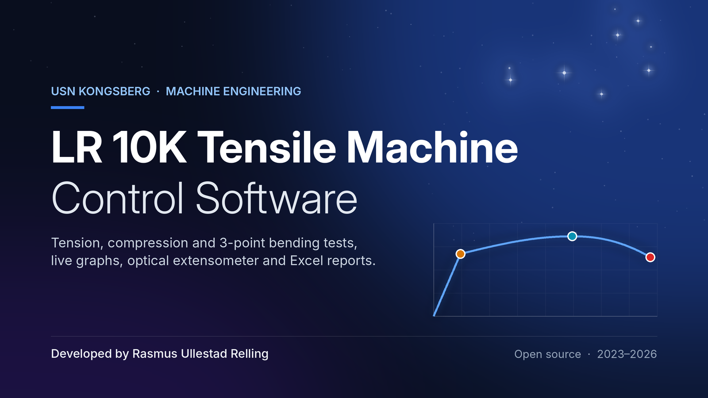
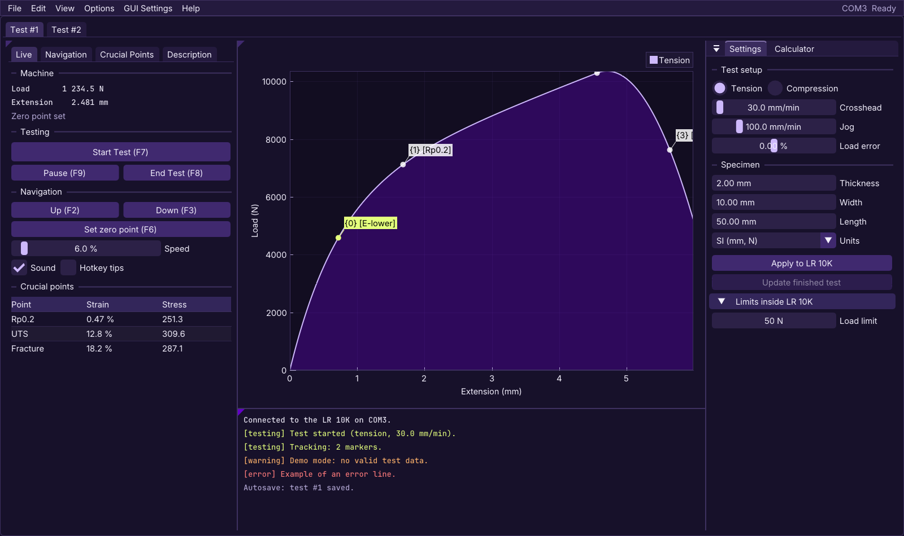
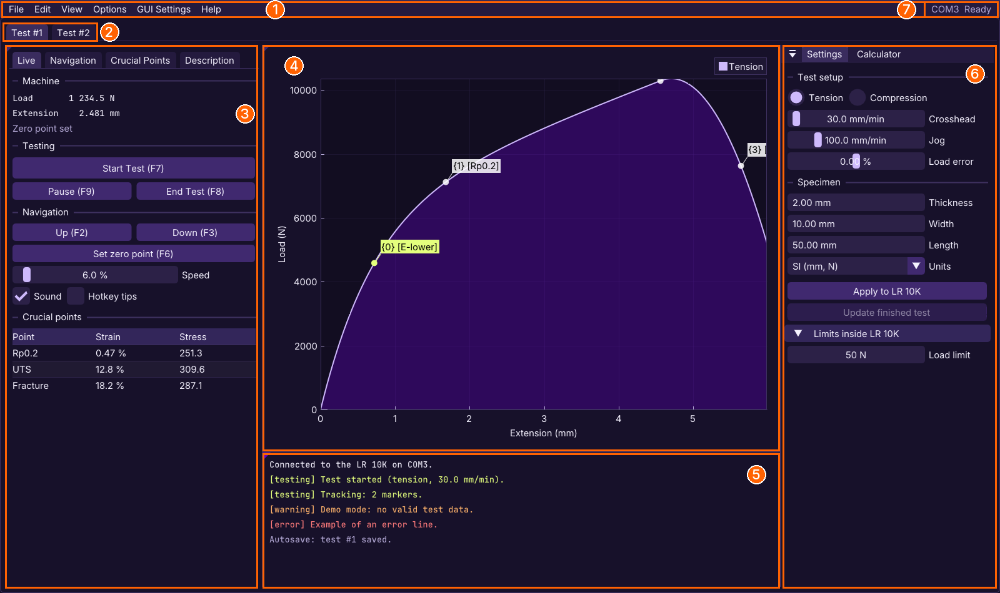
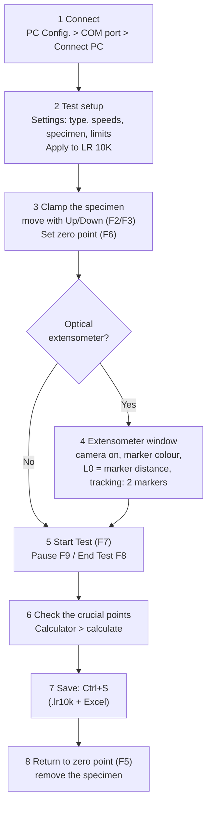
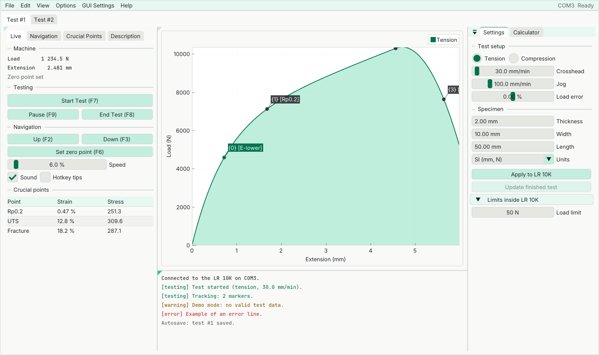
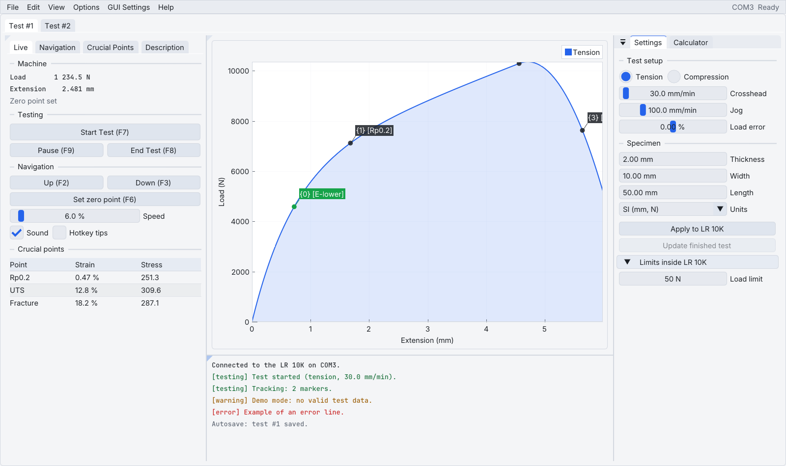
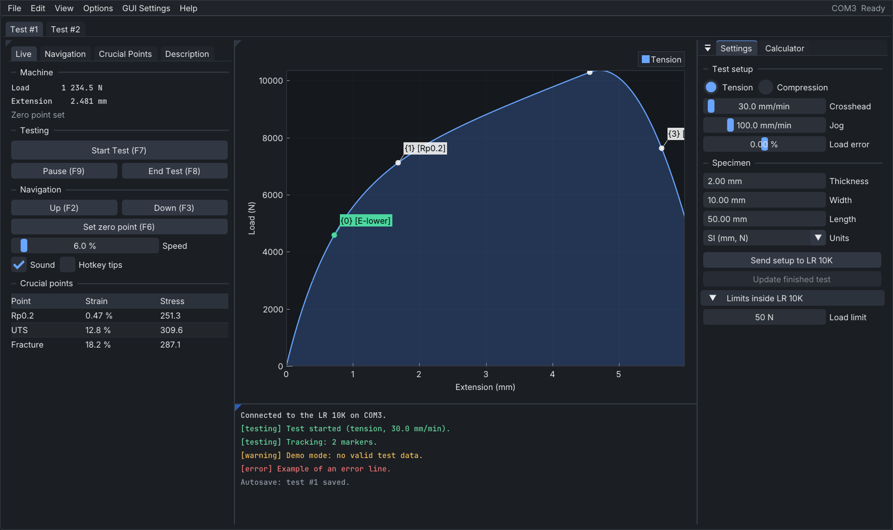

<p align="center"></p>

LR 10K Control Software
=======================

**Modern Windows software for the LLOYD LR 10K tensile testing machine (1990s): run tension, compression and 3-point bending tests, follow the load-extension curve live, measure strain with a camera, calculate the material properties and export the results to Excel.**




https://github.com/user-attachments/assets/1e7bd6c5-577c-48bb-ac2a-a7472cb92553


The LR 10K's own PC software (*Lloyd Instrument Data Analysis Package Dpmat 2.2*) runs on DOS. This program replaces it: it talks to the machine over its serial (COM) port with the same commands, and adds what a lab course needs today, such as a live graph, automatic yield points, an optical extensometer, Excel reports and autosave.

It was made at the University of South-Eastern Norway (USN) for students and staff who test materials on the LR 10K. It is tested with version 5.0 of the software built into the machine.

> **Unofficial software, use at your own risk.** This is a student/community project. It is not made, supported or endorsed by Lloyd Instruments or AMETEK, and comes without any warranty (see [LICENSE](LICENSE)). A tensile machine can crush fingers and break specimens violently: follow your lab's safety rules, keep the machine's own stop within reach, and check the results before you rely on them. See [Safety](#safety).

## Contents

- [What it can do](#what-it-can-do)
- [The main window](#the-main-window)
- [Quick start](#quick-start)
- [Documentation: where to look](#documentation-where-to-look)
- [Themes](#themes)
- [Getting and building the software](#getting-and-building-the-software)
- [How it works](#how-it-works)
- [Releases and changelog](#releases-and-changelog)
- [Safety](#safety)
- [FAQ](#faq)
- [Help, bug reports and contributing](#help-bug-reports-and-contributing)
- [Credits, sponsors and license](#credits)

## What it can do

| | |
|---|---|
| **Control the machine** | Connect over a COM port, send the test setup (speeds, tension/compression, limits), move the crosshead (F2/F3), set and return to a zero point, start, pause and end tests (F7-F9). |
| **Live graph** | Load-extension while the test runs; after the test, engineering and true stress-strain. Several tests side by side in tabs. |
| **Crucial points** | The ultimate tensile strength, E-modulus limits, yield strength (Rp0.2) and proportional limit (Rp0.01) are placed automatically when a test ends; move them or add your own (Ctrl+Click, Ctrl+Z to undo). |
| **Calculator** | E-modulus, stress and strain at every point (rectangular or circular specimens), 3-point bending (flexural strength and modulus), SI or English units. |
| **Optical extensometer** | A webcam follows two coloured markers on the specimen and measures their distance to a fraction of a pixel, from 800 x 600 up to 4K. Tests can be recorded as video. |
| **Excel export** | One `.xlsx` book per test: a report, the setup, and charts of load-extension and engineering/true stress. |
| **Safety** | Stops the crosshead above 50 N when moving without a test, and ends a test at the load limit you set. |
| **No lost tests** | Autosave every 5 s during a test; after a crash or power cut, the next start offers to open the unsaved tests again. Crash reports for the developers. |
| **Practice without the machine** | *GUI Settings* > *LR 10K Simulation* > *Activate* runs a simulated machine. |

## The main window



| | Part | What it is for |
|---|---|---|
| 1 | **Menu bar** | *File* (open, save, Excel, storage folder), *View* (show/hide the Calculator, Extensometer and Console windows), *PC Config.* (COM port, *Connect PC*), *GUI Settings* (theme, text size, units, layout reset, simulation), *Help* (tutorial videos and a step-by-step guide). |
| 2 | **Test tabs** | One tab per test. *+ New Test* opens another; opened `.lr10k` files get their own tab. |
| 3 | **Side panel** | Live load and extension, *Start/Pause/End Test*, moving the crosshead, *Set zero point*, the crucial points, a description of the test. |
| 4 | **Graph** | The curve with its crucial points. Drag points with the mouse; zoom with the scroll wheel; switch between load-extension and stress-strain. |
| 5 | **Console** | What the software and the machine are doing, warnings and errors. Read it when something does not respond as expected. |
| 6 | **Settings / Calculator** | The test setup (tension or compression, speeds, specimen dimensions, units, limits) and *Apply to LR 10K*; the Calculator tab calculates the material properties. |
| 7 | **Machine status** | COM port and the machine's state. |

Windows can be moved and docked anywhere by dragging their tab; *GUI Settings* > *Defaults & Resets* > *Reset window layout* puts them back. (The pictures on this page are drawn from the software's own GUI code by `tools/theme_preview.cpp` with example data, not screenshots of a real test.)

## Quick start

Before your first test: install or unzip the software (see [Getting the software](#getting-and-building-the-software)), connect the LR 10K to the PC with its serial cable (a USB-to-serial adapter works), switch the machine on, and start the software. New to the program? *Help* has short videos (*Setup*, *Completing a test*, *Using an extensometer*) and a written *Get Started* guide.

Both workflows start the same way; the extensometer only adds steps 4a-4d.



### Without an extensometer (crosshead travel)

The extension comes from the crosshead's movement. Quick and good for comparing tests, but the E-modulus comes out lower than the material's, because the machine and the grips stretch too.

1. **Connect.** *PC Config.* > pick the COM port of the LR 10K, then *Connect PC*. The console says when it is connected; *Start Test* tells you (as a tooltip) what is still missing.
2. **Set up the test.** In *Settings*: tension or compression, crosshead and jog speed, the specimen's dimensions (thickness and width, or diameter, and gauge length L0), units and the load limit. Press **Apply to LR 10K**.
3. **Clamp the specimen.** Move the crosshead with *Up*/*Down* (F2/F3, hold F4 to go faster) until the specimen sits in the grips without load. Press **Set zero point** (F6). Choose where the results go: *File* > *Specify Storage Folder*.
4. *(extensometer only, see below)*
5. **Run the test.** **Start Test** (F7). *Pause* (F9) and *Continue* (F7) if needed; *End Test* (F8) after fracture. The test also ends at the load limit.
6. **Check the results.** The UTS, E-modulus limits and yield points are placed automatically; look at them, and drag or add points if needed (*Crucial Points* > *Auto-place E-Modulus and Yield* places them again). Calculate the material properties in the *Calculator* to see the stress-strain graphs.
7. **Save.** Ctrl+S saves the test (`.lr10k`, can be opened again) and the Excel book (`.xlsx`). Add a short description first, so similar tests can be told apart.
8. **Finish.** *Return to zero point* (F5) and take the specimen out. *+ New Test* for the next one.

### With the optical extensometer (camera)

The extension is measured between two markers on the specimen, so only the specimen's own stretch counts. Use this when you need the E-modulus or exact strains.

Do steps 1-3 above, then:

- **4a. Prepare.** Put two round markers on the specimen, across the part that will stretch: Ø5 mm dots of bright green (#00FF00) paper, 60 mm apart. The [marker guide](docs/extensometer-markers.md) shows how to make them with a laser cutter and place them with a 3D-printed guide (files in the [extensometer-tracking-marker release](https://github.com/ravo10/lr10k-2027/releases/tag/extensometer-tracking-marker-1.0)). Point a webcam at them (even light, no reflections, camera not moving); the camera and 3D-printed holder used at USN are in the [suggested extensometer setup](docs/extensometer-setup.md).
- **4b. Open the extensometer.** *View* > *Extensometer*, switch the camera on, press **Pick from image** (*Color Segmentation*) and click the middle of a marker in the camera image; the *Mask (binary)* or *Side by side* tab shows what is found. Choose the camera's resolution under *Camera Properties* (older cameras: 800 x 600 or 1280 x 720; 4K cameras: up to 3840 x 2160).
- **4c. Gauge length.** Measure the distance between the two markers as exactly as you can and type it as **L0**. *Tracking* must show **2 markers**.
- **4d. Zero.** *Set zero point* (F6) also sets the optical zero (*Start Test* does it by default too). Turn on *Record* > *Record tests* in the extensometer window if you want a video of the test.

Then continue with step 5. If the markers are lost for more than half a second during the test, the test is paused so no wrong data is recorded. More tips: [user guide, *Optical extensometer*](docs/index.md#optical-extensometer).

## Documentation: where to look

| You want to... | Look at |
|---|---|
| Learn to use the software | *Help* in the software (videos and *Get Started*), and the **[user guide](docs/index.md)**: setup, tests, hotkeys, the automatic points, the extensometer, saving, autosave, problems |
| Make and place extensometer markers | **[Marker guide](docs/extensometer-markers.md)**: size, colour, laser-cut sheet, placement guide and 3D-printable specimens |
| Set up the extensometer camera | **[Suggested extensometer setup](docs/extensometer-setup.md)**: the webcam used at USN and a 3D-printed holder for the LR 10K |
| Know what is in the Excel book | [User guide, *Saving*](docs/index.md#saving-a-successfully-completed-test--excel) |
| Solve a problem (crash, will not start, connection) | [User guide, *Problems with the software*](docs/index.md#problems-with-the-software-crashing-etc) and the *Troubleshooting* table in [BUILDING.md](BUILDING.md#troubleshooting) |
| Build the software or the installer | **[BUILDING.md](BUILDING.md)** |
| Find your way in the source code | **[ARCHITECTURE.md](ARCHITECTURE.md)** (every file and test), the **[SysML architecture diagrams](docs/architecture/README.md)** (structure, data flow, test states, workflow, connecting), then the developer documentation below |
| Read the developer documentation | Doxygen, start page [docs/developer.md](docs/developer.md): run `docs\build-docs.bat` (opens it in the browser), or download *docs-html* from the latest *Docs* run under *Actions* |
| Understand the machine's protocol | [User guide, *Communication*](docs/index.md#how-the-software-communicates-with-the-lr-10k-tensile-machine-outputinput): the recorded command sequences and what the bytes mean |

## Themes

*GUI Settings* > *Theme*. The graph follows the theme, and every text colour is checked for contrast (WCAG AA) by a unit test. *GUI Settings* > *Text size* makes text 90 % to 150 % as large.

| USN (default) | NITO |
|---|---|
|  |  |
| Dark, USN purple. | Light, the greens from NITO's design manual. |
| **Light** | **Dark** |
|  |  |
| Neutral light grey with a blue accent. | Neutral dark grey with a blue accent. |

## Getting and building the software

- **Download:** the ready-to-run program (a `.zip` to unpack, or the `.msi` installer) is attached to each version on the [Releases](https://github.com/ravo10/lr10k-2027/releases) page. At USN, ask the lab staff. Windows 10 or 11 (64-bit); nothing else needs installing. Settings and the window layout are kept in `%LOCALAPPDATA%\LR10K`.
- **What you need:** the LR 10K connected to a serial (COM) port, directly or with a USB-to-serial adapter (at USN: a StarTech.com ICUSB2321F USB to RS232 adapter and a DB25 to DB9 adapter; see [Cable and adapter](docs/index.md#cable-and-adapter)). For the optical extensometer, any USB webcam Windows recognises (a 1080p or 4K camera gives finer strain), and two markers in a bright colour.
- **Build from source:** Visual Studio 2026 (C++), vcpkg and OpenCV 4.12; step by step in [BUILDING.md](BUILDING.md).
- **Tutorial videos:** too large for git, so they are assets of the [`demo-videos-1.0` release](https://github.com/ravo10/lr10k-2027/releases/tag/demo-videos-1.0). After cloning, download them into `main/LloydLR10KTensile/videos/` with the script below:

  ```powershell
  powershell -ExecutionPolicy Bypass -File scripts\fetch-videos.ps1
  ```

  Without them, the Help buttons open the release page instead.

## How it works

The commands the LR 10K understands were found by recording ("sniffing") the serial traffic between the machine and the original DOS software, and decoding what each byte means (see the [user guide](docs/index.md#the-language-of-the-lr-10k-tensile-machine---its-hex-values-and-their-meaning)).

The program is C++20 with [Dear ImGui](https://github.com/ocornut/imgui) (docking) and [ImPlot](https://github.com/epezent/implot) on DirectX 12, [OpenCV](https://opencv.org) for the camera and [libxlsxwriter](https://libxlsxwriter.github.io) for Excel. Separate threads read the COM port, decode the machine's messages, run the camera and write autosaves, so the window stays responsive. The machine protocol, the calculations, the automatic points, the extensometer maths, the Excel contents and the themes are in portable headers with unit tests that run on every push (*Actions* > *Tests*), so most of the software is tested without the machine. [ARCHITECTURE.md](ARCHITECTURE.md) has the details.

## Releases and changelog

**v2.0.0** (November 2026)
- Automatic E-modulus limits, yield strength (Rp0.2) and proportional limit (Rp0.01).
- Optical extensometer: sub-pixel marker centres, steadier tracking, camera resolution up to 4K, video recording, test paused when the markers are lost.
- Autosave during tests and recovery after a crash; crash reports.
- 50 N translation blocker and load limit restored; hotkeys F1-F9.
- Excel export reworked (report, setup, crucial points on the charts).
- Four themes (USN, NITO, Light, Dark) with checked contrast, text size, rounded corners, a default window layout; ImPlot 1.1.
- Fixed: smoothing overestimated the load with an even window, data not converted when units changed, tests always marked unsaved, a crash when opening a missing or damaged file, connection stuck at 6 %.
- Installer for Visual Studio 2026; serial traffic log for connection problems.

v1.0.3: Excel output: the extension in mm starts at the zero point set in the software.  
v1.0.2: Fixed a crash when moving up/down and then quickly up/down.  
v1.0.1: More features, such as an automated saving procedure.  
v1.0.0: Basic functionality.

## Safety

- The software sends movement commands to a machine that can apply up to 10 kN. Keep hands out of the grips while the crosshead can move, and know where the machine's own stop button is: the software's *Stop* (F1) depends on the PC, the cable and the software working.
- The 50 N translation blocker (moving the crosshead without a test) and the load limit are on by default. They act through the software, so they are an extra safeguard, not a replacement for the machine's own limits or for watching the test.
- Wear safety glasses for brittle specimens and composites; they can break with flying fragments.
- The results are only as good as the setup: correct specimen dimensions, a zero point set without load, and a calibrated load cell (*Load error* corrects a known error). Always look at the automatic crucial points before using the numbers.

## FAQ

**Who uses the LR 10K Control Software?**
Students and staff who test materials on the LLOYD LR 10K tensile machine.

**Can you do scientific research with the software?**
Yes. It is meant for research and for teaching: the calculator gives the material properties, the yield points follow the offset method of the tensile test standards, and the Excel book holds the raw data and editable charts for a report. Always check the automatic points, and use the optical extensometer when the E-modulus matters.

**Can I try it without the machine?**
Yes: *GUI Settings* > *LR 10K Simulation* > *Activate*.

**Does it work with other machines, or other LR 10K firmware versions?**
It is only tested with the LR 10K and version 5.0 of its built-in software. Other Lloyd machines of the same generation may use the same commands, but this is untested. If you try, record the traffic (*Log serial traffic to file*) and open an issue with the log.

**Which webcam can I use for the extensometer?**
Any USB webcam Windows recognises. Choose its resolution in the extensometer window; higher gives finer strain. A fixed focus or manual focus, and a stand that does not move, matter more than the resolution. At USN a Logitech BRIO 4K is used in a 3D-printed holder on the machine: see the [suggested extensometer setup](docs/extensometer-setup.md).

**Where are my files?**
Tests and Excel books go to the storage folder you choose (*File* > *Specify Storage Folder*). Settings, window layout and autosaves are in `%LOCALAPPDATA%\LR10K`; crash reports in *Documents\\LR10K crash reports*.

**Why is the software open source?**
So others can add features that everyone gains from. We maintain it as much as we can, but not everyone will have time or access to the machine forever. Please open an issue before starting on a new feature (see below), or show it working (for example in a video) before it is added.

## Help, bug reports and contributing

- **Questions and bug reports:** open an [issue](https://github.com/ravo10/lr10k-2027/issues/new/choose). For a bug, give the version (at the bottom of the *File* menu and of the *Help* window), what you did and what happened. Attach the crash report (*Documents\\LR10K crash reports*, both files) if the program crashed, and a serial log (*Log serial traffic to file*) for connection problems.
- **Contributing:** see [CONTRIBUTING.md](CONTRIBUTING.md): how to build, the tests, the coding conventions and what a pull request needs.
- **Citing the software:** if you use it for a report, thesis or paper, use *Cite this repository* on GitHub (from [CITATION.cff](CITATION.cff)), and state the version.

## Credits

The software was made as a summer project (2023) by mechanical and systems engineering student **Rasmus Ullestad Relling** (main developer), inspired by **Richard Thue** (mechanical engineering teacher and lab engineer), and supported by **Joakim Bjørk** and **Olaf Hallan Graven** (computer engineering teachers), who helped decode and understand the communication between the LR 10K and the computer. It has since been fine-tuned with feedback from students using it in the lab while Rasmus has been taking his industry master's and working at USN as a Systems Engineer (50/50).
Claude Opus has been used as of late 2026 to improve the software like removing critical bugs, improving stabillity and performance, and also the visual representation and documentation of the software.

## Sponsors

University of South-Eastern Norway (USN): access to a 1990s LR 10K tensile machine and a computer for the development.

## License

MIT License, see [LICENSE](LICENSE). The libraries and fonts it uses keep their own licenses (BSD, zlib, Apache 2.0, LGPL, SIL OFL), listed at the end of the same file.
