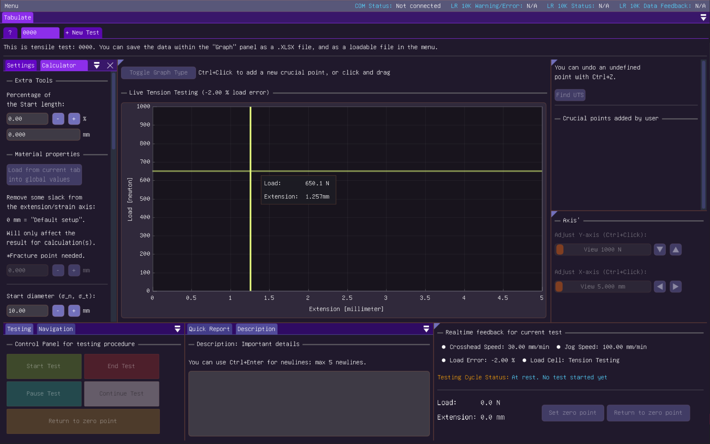
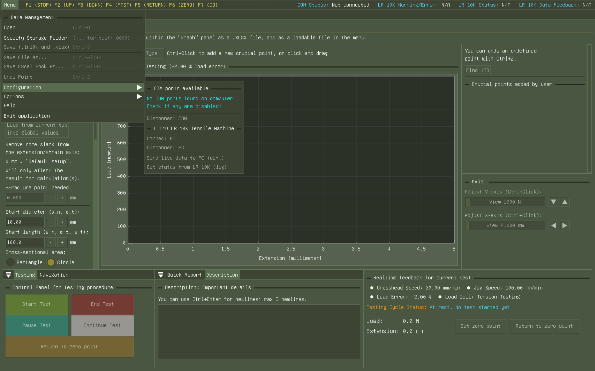

Unofficial LR 10K Control Software
=====

The software was made as a summer project by machine engineering student Rasmus Ullestad Relling. Inspiration from Richard Thue (mechanical engineer teacher/lab engineer) and supported by Joakim Bjørk (computer engineer teacher) and Olaf Hallan Graven (computer engineer teacher) with the decryption and understanding of the communication line between the LR10K Tensile Machine and the computer, which made this software possible to create. Project has gone through a bit of fine tuning currently through 1 semester, where feedback and basic usage of the software has been tested, which created v1.0.1.

### Usage/Docs

Open up the application and go to "Help" for a quick tutorial. In short steps: Connect to COM port on computer, connect to the LR10K Tensile Machine, send new setup and then start a new test. You can access the [full documentaion](docs/index.md) for a tutorial or developement information.

### How it works

Uses the ImGui open source package with C++ for the application, where the binary codes sent to the machine was found by "sniffing" the machine's in/out commands and response. The software is also multi-threaded and uses independent threads that run hooks for handling the data flow and circular buffer. More information on how the software works can be found in the docs above.

The software tries to mimic the same functionalities that the DOS software: **Lloyd Instrument Data Analysis Package Dpmat Version 2.2** has, but with a more *modern* approach.

### Releases & Changelogs

v1.0.1 : Added more features, such as automated saving procedure.  
v1.0.0 : Basic functionallity.  

### Gallery

### Support, Frequently Asked Questions (FAQ)

**Who uses the LR 10K Control Software?**

Students or people who want to perform material testing/research using the LLOYD LR 10K Tensile Machine. (1990's)

**Can you do scientific research with the software?**

Yes, the software is meant to be used for research and is designed to be user friendly for students or experienced people to performe research. It has the basic functionalities built in like material property calculator and export to Excel book. With the Excel book you can save graph picture of the nominal/engineering and true stress, and also edit it later like a normal Excel book - like adding pictures of material test.

**Why is the software open sourced?**

Everything is open sourced so if a community wants to add features to the software with functionality that everyone can gain from, it should be possible to fork the project. We will try and maintain the software as much as needed but not everyone will have the time or access to the machine forever. Maybe getting in contact with some of us could be a good idea before wanting to fork a new feature - or confirm it's functionality in a video or such before being added.

Sponsors
--------

University of South-Eastern Norway - USN | Access to a 1990's LR10K Tensile Machine and a computer to help development

Credits
-------

Developed by: Rasmus Ullestad Relling (main developer), Joakim Bjørk, Olaf Hallan Grave & Richard Thue.

License
-------

LR10K Control Software is licensed under the MIT License, see [LICENSE.txt](LICENSE.txt) for more information.
