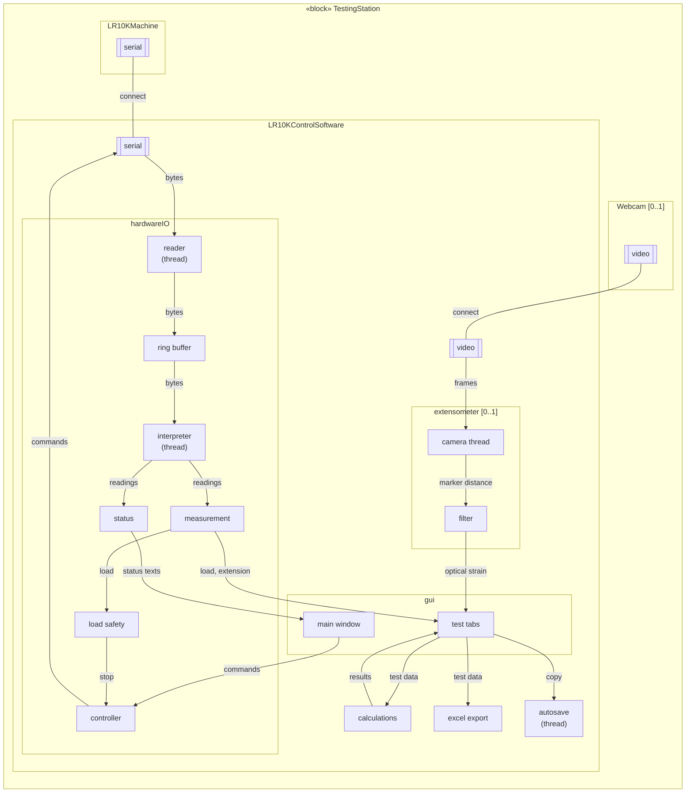
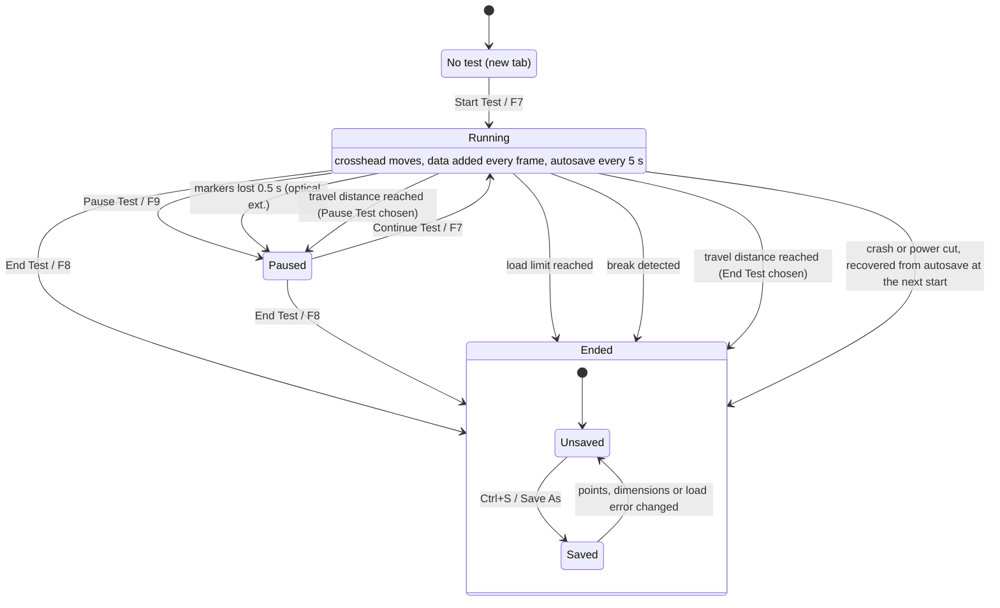
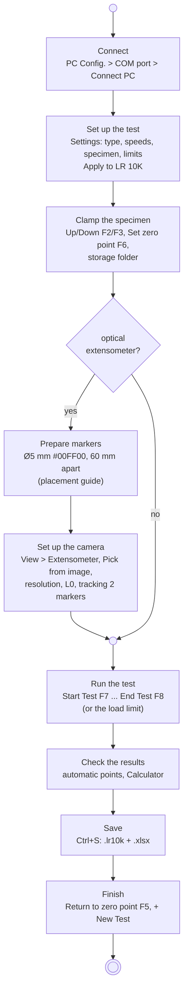
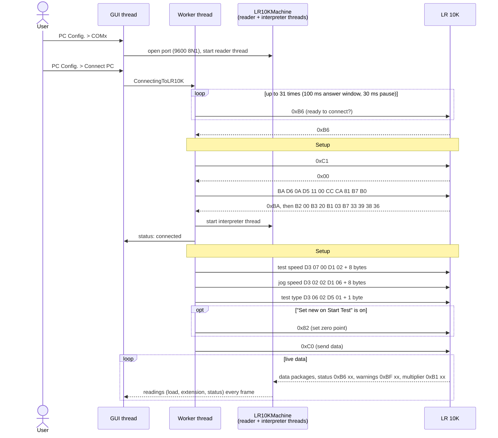

# Architecture diagrams (SysML)

Five views of the LR 10K Control Software, drawn in SysML style. The same model is in SysML v2 textual notation in [lr10k.sysml](lr10k.sysml), which tools such as [SysON](https://mbse-syson.org) or the SysML v2 Pilot Implementation can open and draw themselves. The file list with one line per source file is in [ARCHITECTURE.md](../../ARCHITECTURE.md).

| # | Diagram | Shows |
|---|---|---|
| 1 | [Block definition (bdd)](#1-block-definition-diagram-bdd) | What the software is made of |
| 2 | [Internal block (ibd)](#2-internal-block-diagram-ibd) | How the data flows from the machine and the camera to the graph, the results and the files |
| 3 | [State machine (stm)](#3-state-machine-diagram-stm-a-test) | The states of a test, and the buttons, hotkeys and events between them |
| 4 | [Activity (act)](#4-activity-diagram-act-running-a-test) | Running a test, with or without the optical extensometer |
| 5 | [Sequence (sd)](#5-sequence-diagram-sd-connecting-to-the-lr-10k) | Connecting to the LR 10K: COM port, handshake, setup #1 and #2 |

The diagrams are [Mermaid](https://mermaid.js.org), which GitHub draws on this page. Mermaid has no real SysML notation, so the SysML elements are shown with its closest shapes: blocks as classes marked `«block»`, ports as small boxes on the edge of a block, flows as labelled arrows.

## 1. Block definition diagram (bdd)

The software and its parts. A filled diamond means "is made of"; the numbers are how many (`0..1`: optional, `1..*`: one or more).

```mermaid
classDiagram
    direction LR
    class TestingStation {
        <<block>>
    }
    class LR10KMachine {
        <<block>>
        LLOYD LR 10K, up to 10 kN
        port serial
    }
    class Webcam {
        <<block>>
        USB camera
        port video
    }
    class LR10KControlSoftware {
        <<block>>
        C++20, Dear ImGui + ImPlot, DirectX 12
        port serial
        port video
    }
    TestingStation *-- "1" LR10KMachine
    TestingStation *-- "1" LR10KControlSoftware
    TestingStation *-- "0..1" Webcam

    class HardwareIO {
        <<block>>
    }
    class Calculations {
        <<block>>
    }
    class OpticalExtensometer {
        <<block>>
    }
    class ExcelExport {
        <<block>>
    }
    class GUI {
        <<block>>
    }
    class Autosave {
        <<block>>
    }
    class CrashHandler {
        <<block>>
        CrashHandler.h, CrashReport.h
    }
    LR10KControlSoftware *-- "1" HardwareIO
    LR10KControlSoftware *-- "1" Calculations
    LR10KControlSoftware *-- "0..1" OpticalExtensometer
    LR10KControlSoftware *-- "1" ExcelExport
    LR10KControlSoftware *-- "1" GUI
    LR10KControlSoftware *-- "1" Autosave
    LR10KControlSoftware *-- "1" CrashHandler

    class MachineConnection {
        <<block>>
        LR10KMachine.h
        port, ring buffer,
        reader + interpreter threads
    }
    class Measurement {
        <<block>>
        LR10KMeasurement.h
    }
    class MachineStatus {
        <<block>>
        LR10KStatus.h
    }
    class LoadSafety {
        <<block>>
        LoadSafety.h
        50 N blocker, load limit
    }
    class Controller {
        <<block>>
        LR10KController
        command sequences
    }
    HardwareIO *-- MachineConnection
    HardwareIO *-- Measurement
    HardwareIO *-- MachineStatus
    HardwareIO *-- LoadSafety
    HardwareIO *-- Controller

    class TestCalc {
        <<block>>
        TestCalc.h, MaterialCalc.h
    }
    class TestDataOps {
        <<block>>
        TestData.h
    }
    class AutoPoints {
        <<block>>
        AutoPoints.h
        E-modulus, Rp0.2, Rp0.01
    }
    Calculations *-- TestCalc
    Calculations *-- TestDataOps
    Calculations *-- AutoPoints

    class CameraThread {
        <<block>>
        ExtensiometerWorkerThread
    }
    class MarkerCentroid {
        <<block>>
        ExtensometerCentroid.h
    }
    class MarkerTracking {
        <<block>>
        ExtensometerTracking.h
    }
    class ExtensometerFilter {
        <<block>>
        smoothing, dead-band, noise
    }
    class MarkerColourPick {
        <<block>>
        eyedropper, hue wrap
    }
    OpticalExtensometer *-- CameraThread
    OpticalExtensometer *-- MarkerCentroid
    OpticalExtensometer *-- MarkerTracking
    OpticalExtensometer *-- ExtensometerFilter
    OpticalExtensometer *-- MarkerColourPick

    class ExcelReportBuilder {
        <<block>>
        ExcelReport.h
    }
    class ExcelWriter {
        <<block>>
        libxlsxwriter
    }
    ExcelExport *-- ExcelReportBuilder
    ExcelExport *-- ExcelWriter

    class MainWindow {
        <<block>>
        appstructs.cpp, main.cpp
    }
    class TestTab {
        <<block>>
        TabSystem.cpp
    }
    class Themes {
        <<block>>
        ThemePalette.h, ThemeApply.h
    }
    class SettingsFile {
        <<block>>
        lr10k_settings.ini
    }
    GUI *-- "1" MainWindow
    GUI *-- "1..*" TestTab
    GUI *-- "1" Themes
    GUI *-- "1" SettingsFile
```

## 2. Internal block diagram (ibd)

Inside a testing station: the parts as boxes, their ports on the edges, and what flows along each connection. Threads are marked; everything else runs on the GUI thread.

## 3. State machine diagram (stm): a test

One tab. The automatic points (UTS, E-modulus limits, Rp0.2, Rp0.01) are placed when the test enters *Ended*. *Start Test* needs a connection (or *LR 10K Simulation*), a zero point and a storage folder; its tooltip says what is missing.

## 4. Activity diagram (act): running a test

The workflow from the [README quick start](../../README.md#quick-start). The decision is whether the optical extensometer is used.

## 5. Sequence diagram (sd): connecting to the LR 10K

From *PC Config.* to live data. The bytes are the ones recorded from the original DOS software (user guide, *Communication*); the handshake and setup #1 are checked against a recorded session in `tests/connect_replay_test.cpp`.

## Keeping the diagrams up to date

When a part is added, moved or renamed (a new header in ARCHITECTURE.md, a new thread, a new state of a test), change both the `.sysml` model and the diagram here. The model validates without errors or warnings with the SysML v2 Pilot Implementation 0.59.0 (checked with the *SysML v2 Co-Pilot* plugin for Claude, which runs the official compiler). Check it again after a change, or open it in SysON or the Pilot's Jupyter kernel. Avoid SysML v2 keywords as names (`connection`, `connect`, `frame`, `filter`, `state`, `action`, ...) and built-in names such as `start` and `done`.
