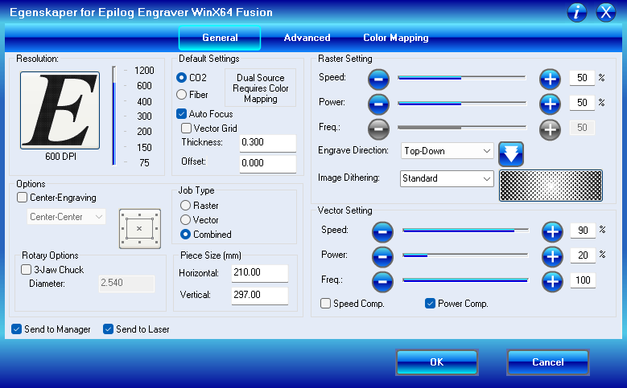
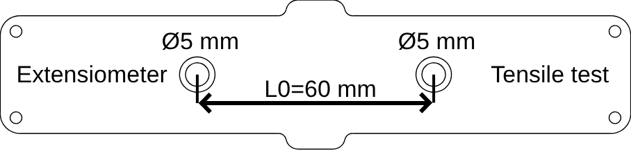
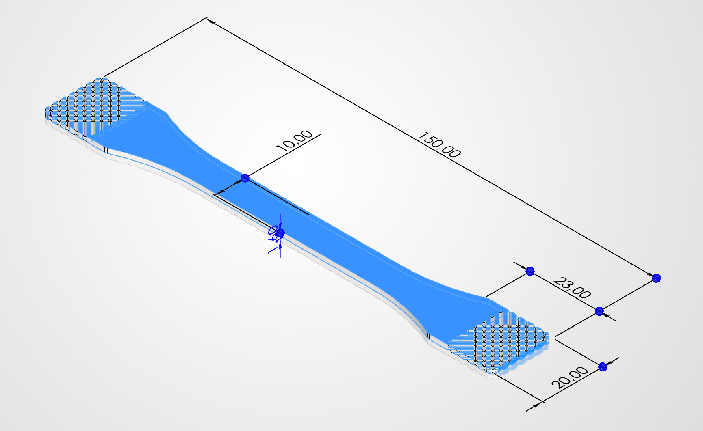

# Extensometer markers

The optical extensometer measures strain from the distance between **two coloured dots** on the specimen. How well the dots are made and placed decides how exact the strain is. This page describes the markers that are used at USN and how to make them.

All the files are attached to the **[extensometer-tracking-marker release](https://github.com/ravo10/lr10k-2027/releases/tag/extensometer-tracking-marker-1.0)**:

| File | What it is |
|---|---|
| `ekstensometer-tracking-markers-A4.fs` | A sheet of marker circles for an A4 page, for FlexiDESIGNER 12 |
| `ekstensometer-tracking-markers-A4.dxf` | The same sheet as `.dxf`, for other laser software |
| `tensile-tester-extensiometer-placement-guide.zip` | A 3D-printable guide that puts the two markers 60 mm apart (L0 = 60 mm) |
| `tensile-tester-extensiometer-placement-guide-top.svg` | The text and arrows on top of the placement guide (also in this repository: [docs/extensometer/](extensometer/tensile-tester-extensiometer-placement-guide-top.svg)) |
| `tensile-tester-specimen-3D-print.zip` | 3D-printable test specimens; one is 1 mm thick and fits the placement guide |

## The marker

| | Recommended | Why |
|---|---|---|
| **Shape** | A round dot | The software finds the centre of each dot to a fraction of a pixel; a clean circle gives the most exact centre. |
| **Size** | **Ø5 mm** | Large enough to cover many pixels in the camera image, small enough that the centre is well defined. |
| **Colour** | **Bright green, #00FF00** | The software's default marker colour (*Color Segmentation (HSV)* > *Default* in the extensometer window). Green stands out from metal, grey and black specimens, and from the machine. |
| **Surface** | Matt paper (0.1 mm A4) | No reflections, and thin enough to follow the specimen without stiffening it. |
| **Gauge length L0** | **60 mm** between the centres | Set by the placement guide. A longer L0 gives finer strain; it must fit on the specimen's parallel length and in the camera image. |

Use only two dots of the marker colour in the camera image: other green objects (tape, labels, clothing) can be mistaken for markers. *Region of Interest* in the extensometer window hides the sides of the image if needed.

## Making the markers (laser cutter)

1. **Print** an A4 sheet of 0.1 mm paper completely in green #00FF00 (a full-page rectangle in any program). Matt paper is best.
2. **Cut** the circles with a laser cutter, from `ekstensometer-tracking-markers-A4.fs` (FlexiDESIGNER 12) or `ekstensometer-tracking-markers-A4.dxf`. The circles in the files are **Ø6 mm**: the laser burns away about 1 mm, so the markers come out **Ø5 mm**. With another laser or other settings, measure one marker and adjust the circle size if needed.
3. Settings used on an **Epilog Laser Fusion M2 32 / 40 (Model 13000 / 14000)** for paper:

   

   In short: 600 DPI, CO2, Auto Focus, job type *Combined*, piece size 210 × 297 mm (A4), **Thickness 0.100** (the paper; the picture shows 0.300, use 0.100). The circles are cut with the **vector** settings: speed 90 %, power 20 %, frequency 100, *Power Comp.* on (raster: speed 50 %, power 50 %). Other laser cutters: start with a low power and test one circle first, so the paper is cut through without burning the edges.

Without a laser cutter, a Ø5 mm hole punch through the green paper, or round green stickers of about that size, also work. The edges must be clean and round.

## Placing the markers

1. 3D-print the placement guide from `tensile-tester-extensiometer-placement-guide.zip`:

   

2. Lay the guide on the specimen and put one marker in each opening, so the two centres are **60 mm apart** and on the specimen's centre line, inside the parallel length.
3. Glue them flat (for example with a glue stick or thin double-sided tape). Raised edges cast shadows and make the dot look smaller on one side.
4. In the software, type **L0 = 60 mm** (or the distance you measured) in the extensometer window.

## Test specimens (3D printing)

`tensile-tester-specimen-3D-print.zip` contains specimens for 3D printing, for practising or for testing printed materials. The 1 mm thick specimen fits the placement guide. Size: 150 mm long, 10 mm wide in the parallel part, 20 mm wide grip ends that are 23 mm long. The parallel part is long enough for the 60 mm gauge length.

## In the software

1. *View* > *Extensometer*, switch the camera on.
2. Under *Color Segmentation (HSV)*, press *Default* (green), or pick the colour of your markers with *Target Color*. The *Mask (binary)* or *Side by side* tab must show the two dots as white, round blobs, and nothing else.
3. Type L0 (60 mm with the placement guide). *Tracking* must show **2 markers**.
4. *Set zero point* (F6) also zeroes the optical extension.

More about the extensometer (resolution, smoothing, dead-band, recording) is in the [user guide](index.md#optical-extensometer).

## Troubleshooting

| Problem | Try |
|---|---|
| Only 1 marker found, or the markers are lost now and then | More even light; check that both dots are in the image and not in shadow; pick the colour again with *Target Color* while the specimen is in place. |
| More than 2 markers found | Remove other green objects from the image, or narrow the *Region of Interest*. Look at the *Mask (binary)* tab to see what is found. |
| The strain jumps or drifts at rest | Reflections or a dot that is not flat. Use matt paper, glue the dots flat, and check *Measured noise* under *Dead-band* (should be about 0.01-0.04 px). |
| The dots look oval or ragged in the mask | The laser burnt the edges (lower the power), or the camera is not square to the specimen. |
