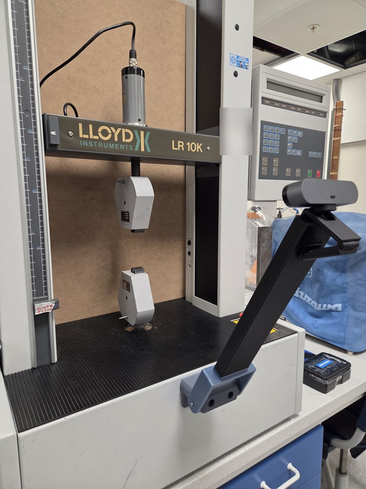
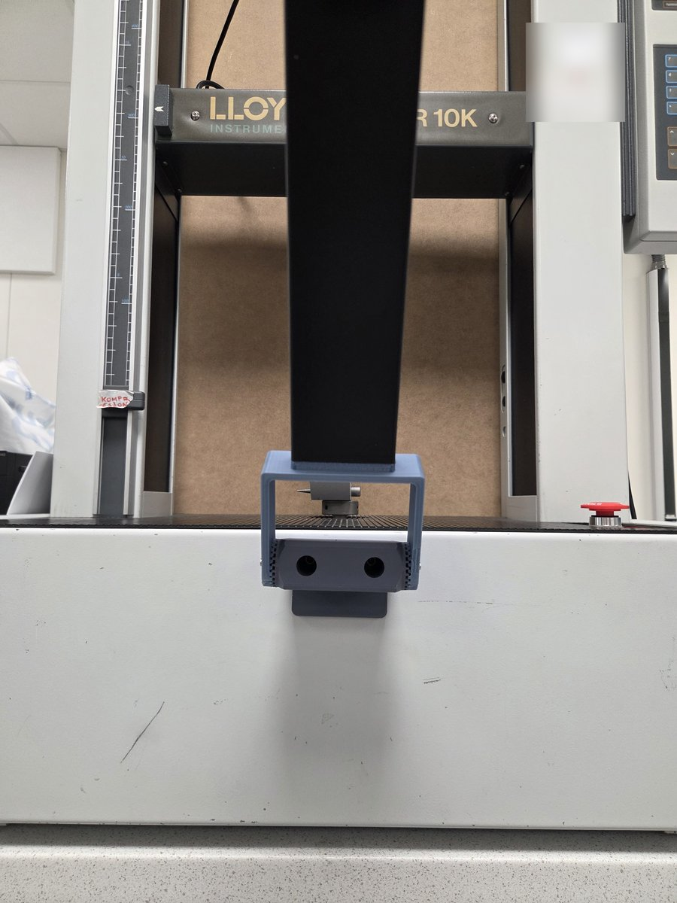

# Suggested extensometer setup

The optical extensometer works with any USB webcam Windows recognises. This page describes the setup used at USN: the camera, the changes made to the LR 10K, and the 3D-printed holder that fixes the camera to the machine. A camera that is fixed to the machine stays square to the specimen and does not move during the test, which matters more for the strain than the resolution.

The 3D models are attached to the **[extensiometer-holder-lr10k release](https://github.com/ravo10/lr10k-2027/releases/tag/extensiometer-holder-lr10k-1.0)**.

How to make and place the markers: [Extensometer markers](extensometer-markers.md).

| The holder on the LR 10K | From the front |
|---|---|
|  |  |

## The camera

| | |
|---|---|
| Camera | Logitech BRIO 4K, USB |
| Resolution | Up to 3840 × 2160; choose it in the extensometer window under *Camera Properties* |

The software turns the camera's autofocus, automatic exposure and automatic white balance off when it opens the camera, so the picture does not change during a test. If the console says that the white balance could not be turned off, turn it off in Logitech's own camera software.

## Changes to the LR 10K

The holder is screwed to the **front panel of the machine's base, in front of the crossheads**, in the middle, below the bottom grip:

- Two **M3 threaded holes**, about **42 mm apart**, drilled and tapped in the centre of the front panel.
- The panel is thin sheet metal, so an **M3 nut is TIG welded on the back** of each hole to give the screw more thread.
- The bare metal was **spray painted** afterwards against rust.

Measure the distance between the holes on the holder you print before you drill, so the holes line up.

## The holder (3D models)

Everything is in `extensiometer-holder.zip` in the [release](https://github.com/ravo10/lr10k-2027/releases/tag/extensiometer-holder-lr10k-1.0). The holder has three printed parts:

| Part | File | Size (mm) | What it is |
|---|---|---|---|
| Base | `extensiometer-holder.STL` | 84 × 70 × 57 | Screwed to the front panel with the two M3 screws |
| Socket | `extensiometer-holder-top.STL` | 94 × 30 × 92 | Fixed on the base; the arm sits in it |
| Arm | `extensiometer-holder-top-bar.STL` | 20 × 60 × 280 | The bar from the socket up to the camera |

The zip also has the SolidWorks files (`.SLDPRT` for each part and the assembly `assm-extensometer-holder.SLDASM`) if you want to change the holder, for example for another camera or another hole distance.

In the photos the arm leans to the side because it was made too long; a shorter arm will follow.

Also needed: **2 M3 × 20 mm screws** for the base.

### Printing

The holder at USN is printed in **PLA**. For the base and the socket, **PETG is suggested, with PLA as the support material**: PETG is tougher, and PLA support comes off PETG easily. The arm can be printed in PLA.

## Mounting it

1. Print the three parts (`extensiometer-holder.zip` in the [release](https://github.com/ravo10/lr10k-2027/releases/tag/extensiometer-holder-lr10k-1.0)).
2. Screw the base to the front panel with the two M3 × 20 mm screws.
3. Fix the socket on the base, put the arm in the socket, and put the camera on top of the arm. Connect it to the PC.
4. Clamp a specimen with markers, open *View* > *Extensometer* and choose the camera under *Hardware*.
5. Check in the camera picture that the specimen is upright and in the middle, and that both markers are well inside the picture for the whole stretch. Even light, no reflections on the markers.
6. Do not touch the camera or the holder during the test: if the camera moves, the markers seem to move.
